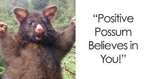

# Please pass the exam!

The exam is worth **40% of the unit**. You must score **at least 40% in the exam** to meet the hurdle; you also need **at least 50% overall** and must meet the other unit requirements.

# Exam tips

{height=200px}
{height=200px}
{height=200px}
{height=200px}
{height=200px}
{height=200px}
{height=200px}
{height=200px}

(don't be Norman Osborn)

## General information

- Essay-style exam. **This is the sort of exam that you can prepare for!**
- Three sections (120 marks total, 2 hours):
  - Section A: Module 1 (60 marks) - Januar
  - Section B: Module 2 (30 marks) - Clare
  - Section C: Module 3 (30 marks) - Mat
- Each module asks a very specific type of question(s)

### You will not be surprised by the question types if you have prepared well by practising the stuff that you can prepare for.

## Writing tips for essay-style exams

1. **Plan your time.** The marks allocated to each section roughly indicate how much time you should spend on it.
2. **Answer in plain English.** Dot points are often not enough and you will be penalised for not explaining your answers.
3. **Plan examples.** Yes, we will definitely ask for examples. **This is something that you can prepare for beforehand.** Prepare an example for each of:
   - one-sample, paired, and two-sample t-tests
   - one-way and two-way ANOVA, with or without control variable(s)
   - linear regression/multiple regression

# Start studying now. You cannot guess your way through this exam. There are no MCQs or short answer questions.

## Section A (Questions 1 and 2)

#### Two compulsory questions 30 marks each, for a total of 60 marks.

### Question 1

- You will be asked to explain specific experimental design concepts and provide examples of their application in biological research.
- You are asked only to explain some of the concepts listed, not all of them, giving you some choice in what to answer **e.g. 3 out of 5 concepts.**
- These concepts are not random; they will be interrelated to each other and to the overall theme of the question; therefore **your answer will reflect your understanding of how these concepts fit together in the context of experimental design**.

## Section A (Questions 1 and 2)

#### Two compulsory questions 30 marks each, for a total of 60 marks.

### Question 1 -- How to prepare

- **Key concepts:** randomisation, replication, blocking, control, pseudoreplication, independent and dependent variables, confounding variables, fixed and random effects, types of data (categorical, continuous), assumptions of statistical tests (LINE).
- For each concept, prepare:
  - A clear and concise definition/explanation
  - An example of its application in biological research (if you are not creative, take one from lectures, practicals, or reports)

## Section A (Questions 1 and 2)

#### Two compulsory questions 30 marks each, for a total of 60 marks.

### Question 2

- You will interpret an experimental scenario, its design, and results.
- You will be asked to explain the results, discuss potential limitations, and identify improvements to the experimental design.
- There will be multiple ways to approach the question; many answers will be possible. **This is where your understanding of experimental design concepts from Question 1 will help you.**

## Section A (Questions 1 and 2)

#### Two compulsory questions 30 marks each, for a total of 60 marks.

### Question 2 -- How to prepare

- Know how to interpret the following:
  - Different types of graphs (bar plots, box plots, scatter plots)
  - Summary statistics (mean, median, variance, standard deviation, standard error)
  - Basic statistical test summaries (t-tests, ANOVA, regression analysis). **A general linear model can be summarised using both an ANOVA table and a regression coefficient table.**
  - Interaction plots, estimated marginal means plots with 95% CIs, and post-hoc test results

## Section B (Question 3)

#### Pick **one** of the *two* questions in this section. Aim to spend 30 minutes on this section.

### Question type 1

> I describe a biological observation and a proposed idea explaining what’s going on. As a consultant, you have been employed to advise whether this idea is reasonable. You have funding to undertake research for two years for this project, as one of a number of projects you will be running in that time. I ask you to describe what experimental approach you would use to test the idea and so answer the biological question. What is your hypothesis, what is your statistical model and what statistical analysis would you use? Why are these appropriate?

## Section B: How to prepare for question type 1

1. Imagine you have a real consulting job in biology. Make up a plausible scenario and answer it.
2. Another way to test yourself with this would be to look at one of the projects you did **NOT** do for your Report 1 and write down an answer similar to that for the above i.e. how would you design your project? Test whether you can do this in 30 mins.
3. **Prepare a list of possible experimental design templates for different types of biological questions (e.g. comparing means between groups, testing for relationships between variables, factorial designs, etc.) and know which statistical tests would be appropriate for each design.**

## Section B

#### Pick **one** of the *two* questions in this section. Aim to spend 30 minutes on this section.

### Question type 2

> I describe a biological study and present some of the results in a table and/or figure. I ask you to discuss the experimental design and results of the study, indicating their strengths and weaknesses and justifying your opinions. Describe how you would improve the design if you were to repeat the study.

Unlike Section A, Question 2, the emphasis here is on evaluating the design and results, rather than explaining what the results show.

## Section B: How to prepare for question type 2

- Read the scientific literature and ask yourself the same questions.
- Review all the key concepts that you would have learned in Module 1 and think about how they apply to the study.
- Read the examples of "best reports" provided on Canvas and see if you can answer the same questions. Check Canvas for the examples made available by Clare.

## Section C (Questions 4 and 5)

#### Two compulsory questions 15 marks each, for a total of 30 marks. One question contains two choices; pick one. The other question is compulsory.

### Question 4

You will be asked to consider the theory underpinning different approaches to the multivariate analyses presented and how these are applied in biology by providing examples. **There will be two choices; pick one.**

### How to prepare

- Review lecture notes and practical exercises on multivariate analyses (PCA, NMDS, cluster analysis, PERMANOVA).
- Understand the assumptions, strengths, and limitations of each method.
- Understand the **steps** involved in conducting these analyses, from data preparation to interpretation of results, as we may ask you why certain steps are necessary (e.g. data transformation, standardisation).

## Section C (Questions 4 and 5)

#### Two compulsory questions 15 marks each, for a total of 30 marks. One question contains two choices; pick one. The other question is compulsory.

### Question 5

You will be asked to interpret the results of a multivariate analysis presented in a series of figures and/or tables. In particular, you will be asked to explain what the results indicate about the biological system under study.

### How to prepare
- Review lecture notes and practical exercises on interpreting multivariate analyses.
- Practise interpreting PCA biplots, PCA scree plots, PCA variance and PC loadings tables, NMDS plots, PERMANOVA tables, ANOSIM tables and SIMPER results. It is basically a "formula" to explain what each of these plots/tables shows, so practising this will help a lot.

# Thanks!

This presentation is NOT on an open licence due to the sensitive nature of the exam content.
